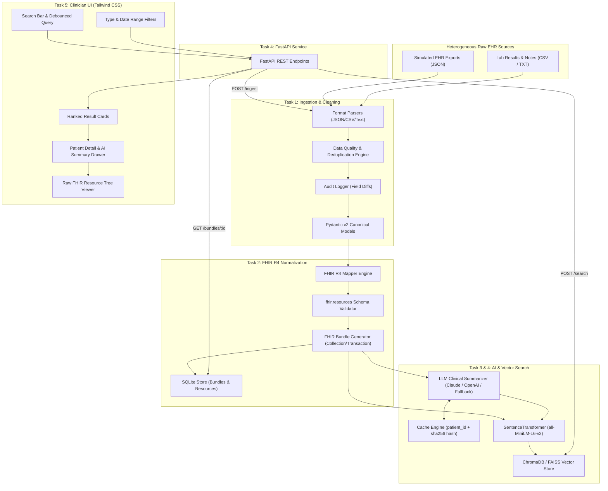

# EHR Media Intelligence Platform: Comprehensive Assessment Execution Plan
**Target Assessment:** Onye 2026 AI Full-Stack Intern Code Assessment  
**Project:** Clinical EHR Media Ingestion, FHIR R4 Normalization, AI Summarization & Semantic Search  
**Tech Stack:** Python 3.11+, FastAPI, Pydantic v2, `fhir.resources`, Sentence-Transformers, ChromaDB / FAISS, SQLite, Tailwind CSS, pytest

---

## 1. Executive Summary & Assessment Breakdown

### 1.1 The Problem Context
Clinical staff working with Epic EHR lose hours every week manually digging through unstructured patient media files—lab reports, imaging notes, discharge summaries, and scanned documents. This project bridges that gap by building an end-to-end AI-assisted clinical media intelligence platform that:
1. Ingests messy, heterogeneous EHR records (JSON, CSV, plain-text).
2. Cleanses and audits data modifications.
3. Maps records to strict HL7 FHIR R4 Bundles (`Patient`, `DocumentReference`, `DiagnosticReport`).
4. Generates concise (<200 words), cached, structured clinical summaries using LLMs (Claude/OpenAI).
5. Provides sub-second semantic search over embeddings.
6. Serves a responsive, accessible clinician dashboard styled with Tailwind CSS.

### 1.2 Core Evaluation Criteria & Rubric Alignment
Reviewers will evaluate this project on four core dimensions:
* **Data Engineering & FHIR Rigor:** Clean schema normalization, edge-case resilience, per-record audit trails, and strict FHIR R4 validation.
* **AI & Search Architecture:** Thoughtful prompt engineering, structured LLM extraction, deterministic hashing/caching, semantic vector retrieval with metadata filtering, and sub-2s latency.
* **Full-Stack Polish:** Clean FastAPI endpoints, clean Tailwind CSS frontend, accessibility (ARIA, keyboard navigation), loading/empty states.
* **Engineering Hygiene:** Dedicated unit tests (`pytest`), structured Git commit history (one commit per major task), clear `README.md`, and a compelling 1-page write-up addressing tradeoffs and evaluation.

---

## 2. Architecture & Design Specification

### 2.1 System Architecture Diagram



### 2.2 Technology Choices & Tradeoffs

| Component | Selected Technology | Alternative Considered | Rationale for Choice |
| :--- | :--- | :--- | :--- |
| **Language & Runtime** | Python 3.11+ | Python 3.10 | Required by spec; native typing improvements, performance speedups. |
| **API Framework** | FastAPI | Flask / Django | Asynchronous, built-in Pydantic v2 integration, automatic OpenAPI docs. |
| **Data Validation** | Pydantic v2 | Dataclasses / Marshmallow | High-performance C-core validation, robust custom validators for dates & MRNs. |
| **FHIR Standard** | `fhir.resources` (R4) | `fhirclient` | `fhir.resources` is modern, actively maintained, and provides strict Pydantic models for FHIR R4. |
| **LLM Provider** | Anthropic Claude 3.5 Sonnet / OpenAI GPT-4o-mini with Mock Fallback | Local LLM (Ollama) | API keys configurable via `.env`; Mock fallback ensures the grader can test locally without paying for API tokens. |
| **Embedding Model** | `all-MiniLM-L6-v2` via `sentence-transformers` | OpenAI `text-embedding-3-small` | 100% local, zero latency cost, runs completely offline, sub-2s query time. |
| **Vector Database** | ChromaDB (in-memory or persistent SQLite) | FAISS / SQLite-vss | Python-native, zero external services required, rich metadata filtering out of the box. |
| **Primary Storage** | SQLite (`sqlite3` / SQLAlchemy) | PostgreSQL / MongoDB | Zero-config, single-file portability, embedded transactions, satisfies local store requirement. |
| **Frontend** | HTML5 / Vanilla JS + Tailwind CSS (served via FastAPI or Vite) | React + Tailwind | Single-page lightweight app with Tailwind CSS eliminates complex npm/node setup for evaluator, or Vite+React if interactive components need complex state. (Vanilla JS + Tailwind CDN or compiled Tailwind keeps setup to a single `uvicorn main:app`). |

---

## 3. Step-by-Step Task Execution Blueprint

### Phase 0: Project Setup & Repository Skeleton
**Objective:** Set up clean directory structure, reproducible packaging, synthetic data generators, and Git workflow.

1. **Repository Layout:**
   ```text
   onye-ehr-intelligence/
   ├── .env.example
   ├── .gitignore
   ├── README.md
   ├── pyproject.toml / requirements.txt
   ├── data/
   │   ├── raw/
   │   │   ├── simulated_ehr_export.json
   │   │   ├── scanned_notes.csv
   │   │   └── lab_results.txt
   │   └── llm_synthetic_generator.py
   ├── src/
   │   ├── __init__.py
   │   ├── config.py
   │   ├── ingestion/
   │   │   ├── __init__.py
   │   │   ├── parsers.py          # JSON, CSV, TXT handlers
   │   │   ├── cleaner.py          # Data cleaning & normalization
   │   │   ├── audit.py            # Audit log data structures
   │   │   └── models.py           # Canonical Pydantic schemas
   │   ├── fhir/
   │   │   ├── __init__.py
   │   │   ├── mapper.py           # Canonical -> FHIR R4 mapper
   │   │   ├── validator.py        # fhir.resources validation engine
   │   │   ├── bundle.py           # Bundle builder
   │   │   └── storage.py          # SQLite repository
   │   ├── ai/
   │   │   ├── __init__.py
   │   │   ├── summarizer.py       # Claude / OpenAI integration
   │   │   ├── prompts.py          # Few-shot / clinical prompts (<200 words)
   │   │   └── cache.py            # SQLite/file cache (patient_id + hash)
   │   ├── search/
   │   │   ├── __init__.py
   │   │   ├── embeddings.py       # sentence-transformers wrapper
   │   │   └── vector_store.py     # ChromaDB wrapper with metadata filter
   │   ├── api/
   │   │   ├── __init__.py
   │   │   ├── app.py              # FastAPI application instance
   │   │   ├── routes.py           # /search, /patients, /bundles, /health
   │   │   └── schemas.py          # API request & response models
   │   └── static/
   │       ├── index.html          # Clinician dashboard
   │       ├── css/style.css       # Tailwind CSS
   │       └── js/app.js           # Client search & modal interaction
   ├── tests/
   │   ├── conftest.py
   │   ├── test_ingestion.py       # 3+ cleaning edge cases
   │   ├── test_fhir_mapping.py    # Bundle & schema tests
   │   ├── test_summarizer.py      # Prompt, length, cache tests
   │   └── test_search.py          # Search latency (<2s) & filter tests
   └── docs/
       └── WRITEUP.md              # 1-page writeup for submission
   ```

2. **Git Commit Strategy (Crucial Deliverable Requirement):**
   The assessment explicitly requires: *"Clean commit history (one commit per major task)"*.
   * Commit 1: `chore: initial repository setup, dependency specs, and synthetic EHR dataset generator`
   * Commit 2: `feat(task1): data ingestion, cleaning pipeline, canonical models, audit trail, and unit tests`
   * Commit 3: `feat(task2): HL7 FHIR R4 mapping, bundle generation, schema validation, and SQLite persistence`
   * Commit 4: `feat(task3): AI-powered clinical summarization with prompt constraints, caching, and disclaimers`
   * Commit 5: `feat(task4): semantic search engine with vector embeddings, filtering, and sub-2s query endpoint`
   * Commit 6: `feat(task5): responsive Tailwind CSS clinician search UI, detail drawer, and accessibility features`
   * Commit 7: `docs: comprehensive README, test suite verification, and final 1-page write-up`

---

### Task 1: Data Ingestion & Cleaning
**Objective:** Parse heterogeneous messy EHR data, fix quality defects, generate canonical models, and record full audit diffs.

1. **Multi-Format Input Ingestion:**
   * **JSON Parser:** Parses simulated exports from Epic Clarity/Caboodle.
   * **CSV / Plain-text Parser:** Parses scanned notes, pathology snippets, and tabular lab reports with messy column names (e.g. `Pt_MRN`, `dob`, `Test_Dt`).

2. **Data Quality Defect Resolution:**
   * **Missing Fields:** Impute safe defaults or flag for review (e.g., unknown gender mapped to `"unknown"`, missing timestamps flagged).
   * **Inconsistent Date Formats:** Normalize diverse formats (`"12/31/1980"`, `"1980-12-31"`, `"Oct 5, 2023 14:30"`, Unix timestamps) into standardized ISO-8601 (`YYYY-MM-DD` and `YYYY-MM-DDTHH:MM:SSZ`).
   * **Conflicting Patient Identifiers:** Merge or reconcile variations (e.g., `"MRN-00123"`, `"123"`, `"MRN 123"` into normalized canonical format `"MRN:000123"`).
   * **Deduplication:** Fuzzy/exact deduplication based on normalized (MRN + Name + DOB) or document content hashing.
   * **Demographic Normalization:** Gender mapped strictly to FHIR administrative codes (`male`, `female`, `other`, `unknown`).

3. **Per-Record Audit Trail System:**
   * Every modification is tracked with a structured record:
     ```python
     class AuditEntry(BaseModel):
         field_name: str
         original_value: Any
         cleaned_value: Any
         transformation_rule: str
         timestamp: datetime
     ```
   * The output model includes `cleaned_record` and `audit_log: List[AuditEntry]`.

4. **Testing Requirements (Minimum 3 Edge Cases):**
   * *Edge Case 1:* Inconsistent / ambiguous dates (e.g. US vs ISO formats, leap years, missing timestamps).
   * *Edge Case 2:* Duplicate records with conflicting non-identifying fields (reconciliation strategy).
   * *Edge Case 3:* Dirty MRNs and malformed gender strings (e.g., `"M"`, `"cis-male"`, `"UNKNOWN"`).

---

### Task 2: HL7 FHIR R4 Normalization
**Objective:** Map canonical intermediate records into strictly validated HL7 FHIR R4 resources and assemble bundles.

1. **Target FHIR R4 Resources:**
   * **`Patient`:**
     * `identifier`: Normalized MRN in system `urn:oid:onye:epic:mrn`.
     * `name`: `HumanName` with family and given names.
     * `gender`: Normalized administrative gender.
     * `birthDate`: Canonical `YYYY-MM-DD`.
   * **`Encounter`:**
     * `status`: `"finished"` (or `"in-progress"` for active visits).
     * `class`: Encounter class coding (e.g., `AMB` for ambulatory, `IMP` for inpatient, `EMER` for emergency) using `http://terminology.hl7.org/CodeSystem/v3-ActCode`.
     * `subject`: Reference to Patient (`Patient/{patient_id}`).
     * `period`: Start and end timestamps of the clinical encounter.
     * `type`: Visit type (e.g., SNOMED CT code for office visit, follow-up, etc.).
     * *Note:* The assessment requires three minimum resource types (Patient, DocumentReference, DiagnosticReport). `Encounter` is added as a supporting resource to provide correct `encounter` references on the other resources, as required by the specification.
   * **`DocumentReference`:**
     * `status`: `"current"`.
     * `type`: Clinical note type (e.g., LOINC code `34108-1` for Outpatient Note or `11488-4` for Consultation note).
     * `subject`: Reference to Patient (`Patient/{patient_id}`).
     * `context.encounter`: Reference to the originating Encounter (`Encounter/{encounter_id}`).
     * `content`: Attachment with base64/plain-text data and MIME type (`text/plain`, `application/pdf`).
     * `date`: Document creation date.
   * **`DiagnosticReport`:**
     * `status`: `"final"`.
     * `code`: LOINC code for lab / radiology (e.g., `24323-8` for Comprehensive Metabolic Panel).
     * `subject`: Reference to Patient.
     * `encounter`: Reference to the originating Encounter (`Encounter/{encounter_id}`).
     * `effectiveDateTime`: Timestamp of test.
     * `conclusion` / `presentedForm`: Summary text of findings.

2. **Validation Engine:**
   * Use `fhir.resources.R4B` (or `fhir.resources.patient.Patient`, etc.).
   * Instantiate models and validate against schemas.
   * Catch validation exceptions and generate a structured **Validation Report** listing invalid fields, missing required properties, and reference errors.

3. **FHIR Bundle Construction:**
   * Aggregate resources into a `Bundle` of type `collection` or `transaction`.
   * Ensure internal relative references (`urn:uuid:...` or relative IDs `Patient/p-101`, `Encounter/enc-201`) resolve correctly.
   * Every `DocumentReference` and `DiagnosticReport` must carry both a `subject` (→ Patient) and an `encounter` (→ Encounter) reference to satisfy the assessment's requirement for *"correct resource references (subject, encounter)"*.

4. **Persistence Layer:**
   * SQLite table `fhir_bundles`:
     * Columns: `id`, `patient_id`, `bundle_json`, `resource_count`, `validation_status`, `validation_errors`, `created_at`.
   * Helper functions: `save_bundle()`, `get_bundle_by_patient_id()`, `list_all_bundles()`.

---

### Task 3: AI-Powered Clinical Summarization
**Objective:** Synthesize multiple unstructured documents into a clinician-grade, 200-word structured summary with strict caching and disclaimers.

1. **Structured Summary Template:**
   * **Chief Concern:** Primary reason for evaluation / clinical encounter.
   * **Key Diagnoses:** Active medical problems and chronic conditions.
   * **Recent Media & Labs:** Imaging highlights, abnormal lab results, and diagnostic notes.
   * **Flagged Anomalies:** High-risk observations (critical lab values, suspicious lesions, medication discrepancies).
   * **Confidence & Safety Disclaimer:** Explicit statement that content is AI-synthesized and not a substitute for clinical judgment.

2. **Prompt Engineering Strategy:**
   * Provide system instruction enforcing:
     * Word count ceiling: Maximum 200 words.
     * Medical precision: Use clinical terminology; do not hallucinate details not in the record.
     * Output format: Strict JSON or markdown bulleted headers.
   * Provide few-shot clinical exemplar in the prompt.

3. **Deterministic Caching Engine:**
   * Compute a hash:
     $$\text{cache\_key} = \text{patient\_id} + \text{SHA256}(\text{all\_document\_texts\_and\_timestamps})$$
   * Check SQLite cache table `summary_cache`:
     * If hit: Return cached summary immediately (0 API latency, 0 token cost).
     * If miss: Call LLM API (Claude 3.5 Sonnet or OpenAI GPT-4o-mini), store response, and return.
   * Add a deterministic offline mock provider so the grader can run tests without providing an API key.

---

### Task 4: Semantic Search Engine & API
**Objective:** Deliver natural language query matching across records with sub-2s response time and metadata filters.

1. **Embedding Pipeline:**
   * Use `all-MiniLM-L6-v2` via `sentence-transformers`.
   * Embeddings computed for:
     * Full document texts (scanned notes, lab conclusions).
     * AI-generated clinical summaries.
   * Document chunks tagged with metadata: `{patient_id, patient_name, mrn, resource_type, record_date, document_id}`.

2. **Vector Indexing (ChromaDB / FAISS):**
   * Persist in local SQLite/Chroma directory.
   * Enable metadata filtering on `resource_type` (e.g. `DocumentReference` vs `DiagnosticReport`) and `record_date` range (`start_date`, `end_date`).

3. **FastAPI Endpoints:**
   * `POST /search`
     * Request Body:
       ```json
       {
         "query": "patients with elevated HbA1c or diabetic neuropathy",
         "resource_type": "DiagnosticReport",
         "date_from": "2023-01-01",
         "date_to": "2024-12-31",
         "top_k": 5
       }
       ```
     * Response:
       ```json
       {
         "query": "...",
         "total_matches": 5,
         "execution_time_ms": 142.5,
         "results": [
           {
             "record_id": "...",
             "patient_id": "...",
             "patient_name": "Jane Doe",
             "mrn": "MRN:004821",
             "resource_type": "DiagnosticReport",
             "record_date": "2023-09-14",
             "relevance_score": 0.892,
             "summary_snippet": "...",
             "document_excerpt": "..."
           }
         ]
       }
       ```
   * Performance SLA: Sub-2 seconds for at least 50 records (target <300ms using local MiniLM).

---

### Task 5: Frontend Search & Summary UI
**Objective:** Provide a fast, accessible, clinician-tailored UI built with Tailwind CSS.

1. **UI Components & Features:**
   * **Header / Navigation:** Clean clinical aesthetic (slate/indigo palette, EHR theme).
   * **Search Bar:** Real-time query input with debounced typing (300ms) or submit on enter.
   * **Filter Bar:**
     * Resource type dropdown: *All Types*, *DocumentReference*, *DiagnosticReport*.
     * Date range inputs: *Start Date* and *End Date*.
     * Clear filters button.
   * **Results Grid / Feed:**
     * Cards showing: Patient Name, MRN badge, Record Date, Resource Type pill (`DiagnosticReport` in purple, `DocumentReference` in blue), Relevance Score bar/badge, and AI summary snippet with query term highlighting.
   * **Patient Detail Drawer / Slide-Over Modal:**
     * Full patient demographic card.
     * Complete AI-Generated Clinical Summary (formatted with sections: Chief Concern, Diagnoses, Media/Labs, Anomalies).
     * Confidence rating & AI disclaimer banner.
     * Expandable tree of linked FHIR R4 resources with raw JSON copy button.
   * **UX States:**
     * Loading skeleton cards during search.
     * Empty state with helpful suggested queries (e.g., *"chest pain with abnormal ECG"*, *"elevated troponin"*).
     * Error toast notifications.
   * **Accessibility & Usability:**
     * Keyboard navigation: `Tab` to navigate cards, `Enter` to open drawer, `Escape` to close drawer.
     * Semantic HTML with `aria-label`, `aria-expanded`, `role="dialog"`.

---

### Deliverables & 1-Page Write-Up Structure
**Objective:** Prepare the exact required deliverables and write-up for submission to Emmanuel (`eobasuyi@onyeone.com`).

The 1-page write-up must concisely address the four required prompts:
1. **Tradeoffs Made and Why:**
   * *In-memory ChromaDB vs external Vector DB:* Zero-dependency local portability vs horizontal scalability.
   * *Local MiniLM vs Cloud Embeddings:* Guaranteed offline testing and zero API cost vs multilingual/domain-specific clinical embeddings (like BioLinkBERT).
   * *SQLite vs Postgres:* Single-file reviewability without Docker overhead for assessment evaluation.
2. **What You Would Improve with More Time:**
   * Hybrid BM25 + dense vector search (Reciprocal Rank Fusion).
   * OCR ingestion pipeline using Tesseract or DocTR for actual scanned handwritten notes.
   * Direct Epic FHIR API / SMART on FHIR OAuth2 integration.
   * Advanced clinical entity extraction (NER) using medspacy or SNOMED-CT / ICD-10 linking.
3. **FHIR or Clinical Concepts Researched:**
   * FHIR R4 resource references (`Reference(reference='Patient/...')`).
   * US Core Data for Interoperability (USCDI) alignment for clinical notes.
   * Distinction between `DiagnosticReport` (interpreted results) and `DocumentReference` (metadata pointer to binary/unstructured content).
   * LOINC and SNOMED-CT clinical terminology coding.
4. **How AI Summary Quality Was Validated:**
   * Prompt constraints and schema validation (enforcing strictly structured sections).
   * Hallucination guardrails: lexical grounding verification (matching extracted lab values against raw source text).
   * Word count automated assertions (<200 words).
   * Clinical evaluation matrix: Completeness, Conciseness, and Factual Faithfulness.

---

## 4. Phase-by-Phase Implementation Checklist

```markdown
- [ ] Phase 0: Environment & Project Setup
  - [ ] Initialize git repo and virtual environment (`uv` / Python 3.11+)
  - [ ] Configure `pyproject.toml` / `requirements.txt`
  - [ ] Create synthetic EHR test generator (JSON + CSV + TXT, >=10 diverse patients)
  - [ ] Make Commit 1: Initial project setup

- [ ] Phase 1: Data Ingestion & Cleaning (Task 1)
  - [ ] Implement `JSONParser`, `CSVParser`, `TextParser`
  - [ ] Implement `DataCleaner` (date normalization, MRN sanitization, gender codes, deduplication)
  - [ ] Implement `AuditLogger` with field-level diffs
  - [ ] Define canonical Pydantic v2 models
  - [ ] Write pytest unit tests covering at least 3 distinct edge cases
  - [ ] Make Commit 2: Task 1 completion

- [ ] Phase 2: FHIR R4 Normalization (Task 2)
  - [ ] Implement `FHIRMapper` mapping canonical models to `Patient`, `DocumentReference`, `DiagnosticReport`
  - [ ] Implement validation logic with `fhir.resources` and error reporting
  - [ ] Implement `BundleGenerator` with proper relative references
  - [ ] Implement SQLite storage for FHIR Bundles
  - [ ] Write unit tests for FHIR validation and bundle retrieval
  - [ ] Make Commit 3: Task 2 completion

- [ ] Phase 3: AI-Powered Clinical Summarization (Task 3)
  - [ ] Implement prompt templates (<200 words, structured sections, disclaimer)
  - [ ] Implement LLM client (Claude / OpenAI + Mock provider fallback)
  - [ ] Implement SQLite/disk caching keyed by `patient_id + hash`
  - [ ] Write unit tests for word count limit, required fields, and cache hit verification
  - [ ] Make Commit 4: Task 3 completion

- [ ] Phase 4: Semantic Search Backend (Task 4)
  - [ ] Integrate `sentence-transformers` (`all-MiniLM-L6-v2`)
  - [ ] Setup ChromaDB collection with metadata filters
  - [ ] Implement `POST /search` endpoint in FastAPI
  - [ ] Support resource type and date range query parameters
  - [ ] Benchmark query speed (ensure <2s for 50 records)
  - [ ] Make Commit 5: Task 4 completion

- [ ] Phase 5: Tailwind CSS Frontend Dashboard (Task 5)
  - [ ] Build responsive layout with search bar, filters, and result cards
  - [ ] Build slide-over patient drawer with full AI summary and FHIR resource viewer
  - [ ] Implement loading skeletons, empty states, and error handling
  - [ ] Add accessibility markup (ARIA labels, keyboard navigation)
  - [ ] Make Commit 6: Task 5 completion

- [ ] Phase 6: Documentation, Write-Up & Verification
  - [ ] Run full pytest suite and ensure 100% pass rate
  - [ ] Create detailed `README.md` with quickstart instructions
  - [ ] Create 1-page write-up (`WRITEUP.md` and exportable PDF)
  - [ ] Verify git log has one clean commit per major task
  - [ ] Make Commit 7: Final polish and submission readiness
```

---

## 5. Ready to Execute?
With this blueprint, every requirement from the assessment specification is mapped to exact technical deliverables, edge cases, tests, and documentation. You can now proceed to implement the project following this plan!

